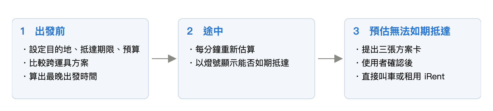

# Hotai AI Hackathon 2026

**Two AI product proposals with clickable prototypes, made for the 2026 Hotai AI Hackathon in Taiwan: trip monitoring for the yoxi ride-hailing app, and risk-aware truck dispatch for HINO.**

2026 和泰 AI 黑客松的兩份 AI 產品提案與可操作原型：yoxi 的整趟行程監控，以及 HINO 商用車的安全排班。

> **Type** Competition (three-person student team) · **Status** Completed (2026-10) · **Role** Product designer · **Stack** Single-file HTML / CSS / JavaScript prototypes

[yoxi prototype (mobile)](https://hunter20041004.github.io/hotai-ai-hackathon-2026/yoxi/prototype/) · [HINO wireframe (desktop)](https://hunter20041004.github.io/hotai-ai-hackathon-2026/hino/wireframe/)

## Background

The team entered two of the hackathon's challenges and submitted a 15-page proposal and a 3-minute video for each in the preliminary round (October 2026):

| Challenge | Our proposal |
| --- | --- |
| yoxi: get people to open the app on days they don't need a ride | **On Track**: monitors the whole trip against an arrival deadline and budget, and only books a car when that is the best option |
| HINO: turn connected-truck data into a smart partner for small fleet owners | **iTRAQ Safe Dispatch**: scores each trip's risk before the truck leaves and links flagged trucks to service booking |

## What it does

**On Track (yoxi)**
- Reads a shared message such as "Friday 19:00 Xinyi" and turns it into a destination, deadline and budget for the user to confirm.
- Ranks options by "on time" or "cheapest", showing the expected and worst-case arrival and the latest time to leave.
- Recalculates a traffic light every minute during the trip; on red it offers three choices: protect the time, protect the budget, or play safe.

**iTRAQ Safe Dispatch (HINO)**
- Drafts the next day's schedule overnight and lists red and yellow trips to review, with the reason and a suggested action.
- Lets the owner change the schedule by voice; the AI repeats the change back before applying it.
- Gives drivers spoken rest reminders and compares predicted and actual risk after each shift.

## My role

- **Me (product designer):** core features, how work is split between AI and algorithms, user flows, system architecture, and both clickable prototypes.
- **Teammates:** project management, business strategy and data analysis.

## Key decisions

| Decision | Why |
| --- | --- |
| Numbers come only from algorithms and models; generative AI never produces a time, price or risk score | In TravelPlanner (2024), LLMs planning trips alone met every constraint only 0.6% of the time. In the design, AI only parses requests and explains trade-offs, and its explanation is checked against the computed numbers. |
| Show the worst case (P95), not just the average | Users fear being late or having an accident; P95 means about 95 out of 100 trips do better. |
| Interrupt only when the traffic light changes | The same light never notifies twice, and every action needs confirmation and can be undone. |

## Results

Backtests below are from our submitted proposals; the organizer's data and our analysis files are not included here.

- **yoxi backtest:** using the organizer's ride data, P95 estimates from two months predicted the next month; about 5% of trips arrived later than the worst case, matching the design target. Using only the median estimate, about half the trips would arrive late.
- **HINO backtest:** on the organizer's connected-truck sample, red-light truck-days were about 5% of days but covered about 25% of fatigue signals. The sample is small, so this shows direction only.
- Two working prototypes, linked above.

## Run it locally

No install needed: use the prototype links above, or open the HTML files in `yoxi/prototype/` and `hino/wireframe/`.

## Notes

Not an official Hotai, yoxi or HINO product. Brand elements only set the scene; times, prices, names and vehicles in the prototypes are illustrative or simulated. This repository holds the prototypes and the figures I made; the organizer's raw data, teammates' reports and internal documents are not included. Built with Claude Code.

## 中文摘要

三人學生團隊參加 2026 和泰 AI 黑客松，報名兩題、各交一份 15 頁提案與 3 分鐘影片。我負責產品設計：核心功能、AI 與演算法的分工、使用流程與系統架構，並做出兩題的可操作原型。兩題共用同一套原則：數字只由演算法和模型產生、講最壞情況（P95）而不只是平均、只有燈號改變時才打擾使用者。yoxi 回測中，約 5% 的行程晚於最壞情況預估，符合設計目標。
