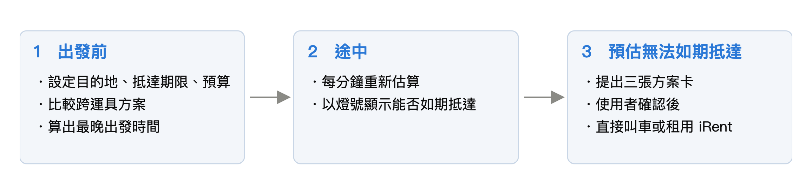
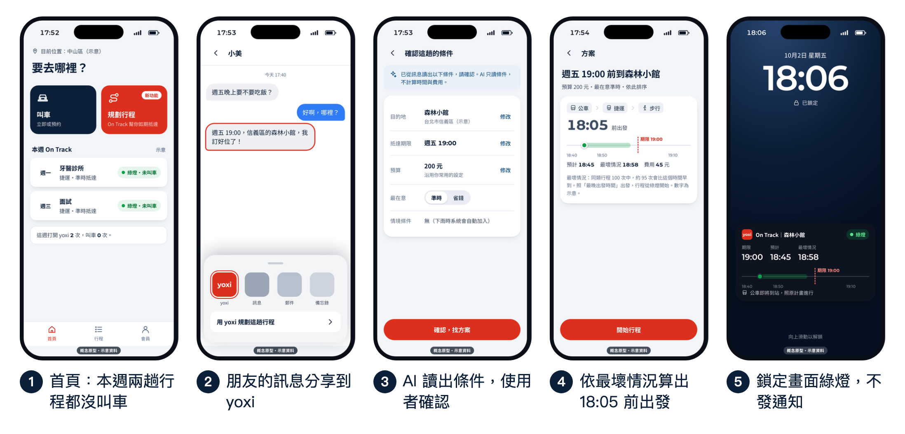
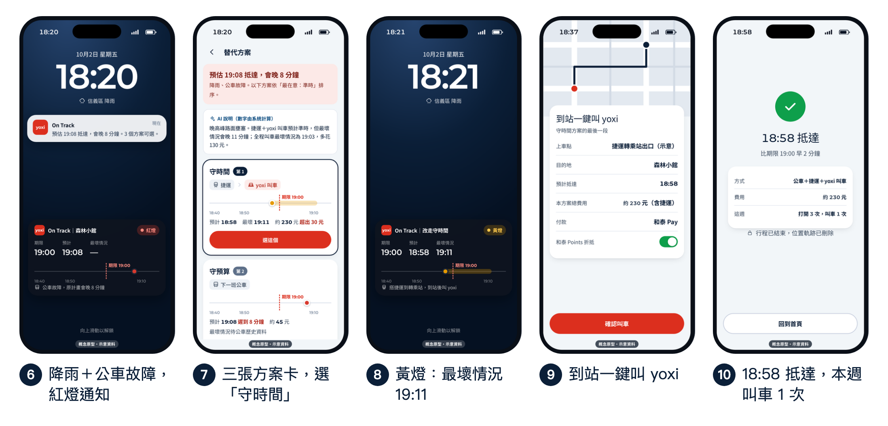
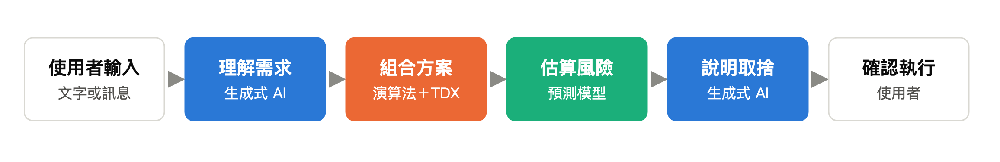
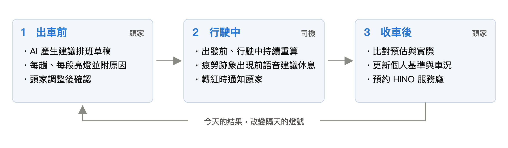
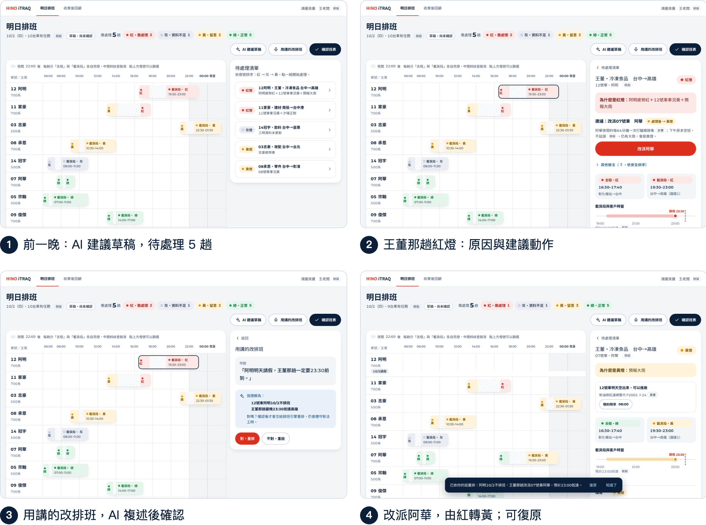
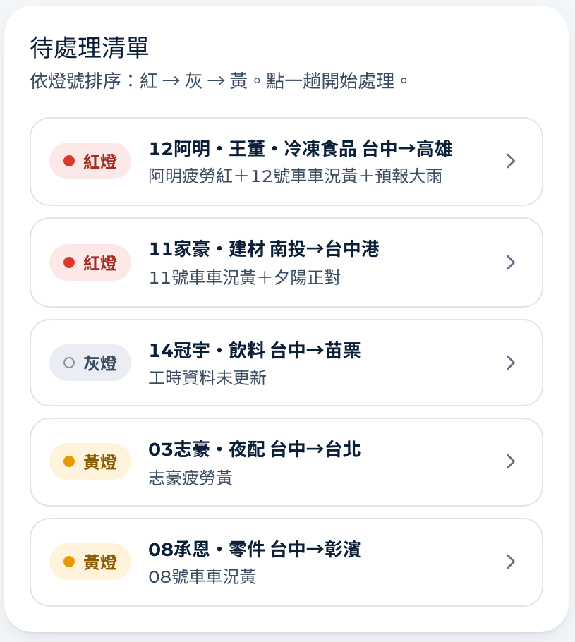
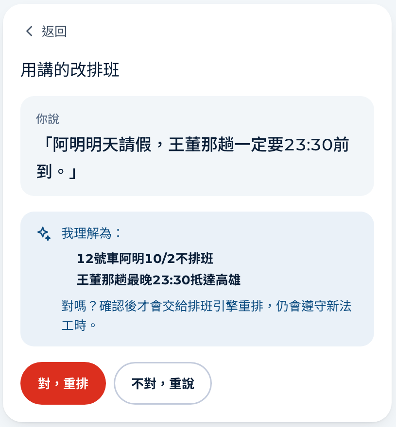
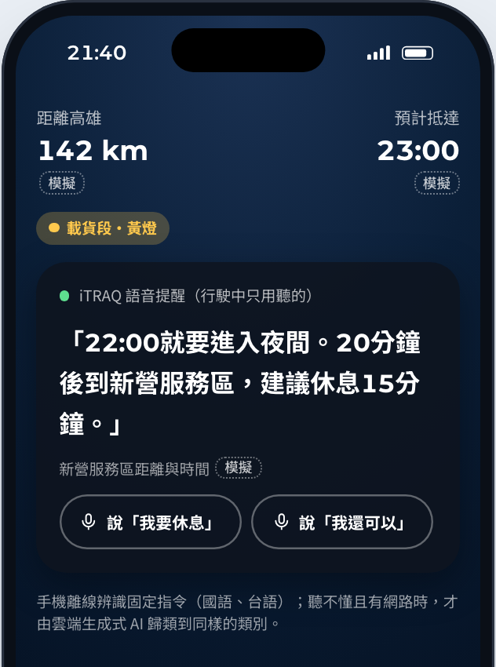

# 2026 和泰 AI 黑客松｜兩份 AI 產品提案

Two AI product proposals for the 2026 Hotai AI Hackathon (Taiwan), built by a three-person student team. I was the **product designer**: product definition, AI division of labor, user flows, system architecture, and both clickable prototypes.

三人學生團隊，報名兩題、各交一份 15 頁提案與 3 分鐘影片，2026/10 完成初賽繳件。我負責產品設計：定義核心功能、規劃 AI 分工、使用流程與系統架構，並做出兩題的可操作原型。PM 與商業策略／數據分析由兩位隊友負責。

> 非和泰、yoxi、HINO 官方作品。原型中的品牌元素只為呈現提案情境，畫面上的時間、費用、人名與車輛都是示意或模擬資料。比賽提供的原始資料不收錄在此。

| 題目 | 提案 | 互動原型 |
| --- | --- | --- |
| 第六題 yoxi：讓使用者在不叫車的日子也會打開 App | **On Track**：依抵達期限與預算監控整趟行程 | [開啟原型（手機畫面）](https://hunter20041004.github.io/hotai-ai-hackathon-2026/yoxi/prototype/) |
| 第四題 HINO：用車聯網資料發展商用車頭家的智慧夥伴 | **iTRAQ 安全排班**：出車前量化單趟風險的派車模組 | [開啟線框稿（桌機畫面）](https://hunter20041004.github.io/hotai-ai-hackathon-2026/hino/wireframe/) |

---

## 我怎麼做產品判斷

兩題用同一套原則：

1. **數字只由演算法和預測模型產生，生成式 AI 不產生任何時間、價格或風險分數。** 生成式 AI 只負責兩件事：把人說的話轉成條件，以及用已算好的數字說明取捨；說明寫完再由程式比對數字是否一致。依據是 TravelPlanner（2024）的結果：讓大型語言模型獨自規劃有預算與時間限制的旅程，全部條件都滿足的比例只有 0.6%。
2. **講「最壞情況」，不只講平均。** 使用者真正怕的是遲到、出事，所以兩題都用 P95（100 次裡約 95 次會比它好）當主要指標，並用歷史資料回測這個估計準不準。
3. **只有用燈號改變行為的時候才打擾人。** 同一燈號不重複通知；動作都要使用者確認，而且可以復原。

## On Track（yoxi）

叫車 App 只在叫車時被打開。On Track 把 yoxi 變成「確保準時抵達」的工具：多數行程用大眾運輸完成，只有在叫車真的是最佳解時才轉成訂單。

**流程**：朋友在 LINE 傳「週五 19:00 信義區」→ 分享到 yoxi，AI 讀出目的地、期限與預算，讓使用者確認 → 依「最在意準時或省錢」排序方案，每個方案顯示預估與最壞情況抵達時間、最晚出發時間 → 途中每分鐘重算燈號 → 轉紅時給三張方案卡：守時間、守預算、最穩妥。

**AI 分工**

**回測**：用主辦方提供的叫車資料，以前兩個月依時段、平日假日與距離分組算出 P95，檢驗下一個月的行程：實際晚於「最壞情況」的比例約 5%，符合設計目標；只看預估時間（中位數）的話，約一半行程會比預估晚到。大眾運輸段需要 TDX 公車歷史資料，留到試辦階段回測。

## iTRAQ 安全排班（HINO）

2026 年 5 月起營業大貨車有新的工時上限，但合法的班表不代表每一趟風險一樣。這個模組讓 5–30 輛車的中小車隊頭家在排班當下看到每一趟的風險燈號和原因，並把需要檢查的車直接接上服務廠預約。

**流程**：前一晚 AI 產生建議排班草稿，把紅、黃燈的趟次列成待處理清單 → 點開看「為什麼是紅燈」與建議動作 → 頭家可以直接用說的改班表，AI 複述後確認 → 行駛中司機收到語音休息建議，只用聽的 → 收車後比對預估與實際，更新隔天的燈號。

| 待處理清單 | 用說的改排班 | 司機端語音提醒 |
| --- | --- | --- |
|  |  |  |

**回測**：用主辦方提供的車聯網樣本回測燈號規則，紅燈車日只占約 5%，卻涵蓋約 25% 的疲勞跡象。樣本小，只用來證明方向，不外推到整個車隊。

## 這個 repo 收錄什麼

- `yoxi/prototype/`、`hino/wireframe/`：可直接在瀏覽器操作的單檔原型（HTML／CSS／JavaScript）
- `*/figures/`：提案中由我產出的流程圖、架構圖與原型截圖

不收錄：比賽提供的原始資料與據此產生的分析檔、隊友的報告與簡報、團隊內部文件。

## 工具

與 Claude Code 協作開發。原型是單檔 HTML；圖表由 Python 產生 SVG 再以 Chrome 輸出；原型截圖以 Playwright 自動擷取，確保圖與原型一致。
